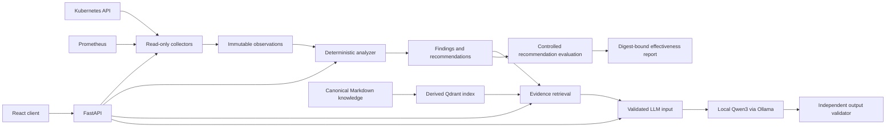

# Kubernetes Resource Intelligence

Kubernetes Resource Intelligence (KRI) is an evidence-first toolkit for
investigating workload resource pressure and evaluating resource recommendations.
It preserves raw Kubernetes and Prometheus observations, performs deterministic
analysis, retrieves relevant operational knowledge, and uses a local LLM only to
explain already-derived findings.

The project is designed around a strict trust boundary: generated prose cannot
invent measurements, change a recommendation, or mutate a cluster. Kubernetes
changes remain explicit operator actions, and controlled experiments require a
reviewed plan and separate approval.

## Architecture



The implemented pipeline keeps five concerns separate:

- deterministic Python computes statistics, conditions, and bounded resource
  recommendations from replay-validated observations;
- RAG retrieves traceable Kubernetes references, runbooks, and incident evidence
  from a rebuildable Qdrant index;
- local Qwen3 inference explains a validated, digest-bound input package;
- an independent validator rejects unsupported numbers, citations,
  recommendations, or missing uncertainty instead of repairing output; and
- a read-only evaluator compares approved baseline/candidate experiments without
  applying recommendations itself.

## Capabilities and safety decisions

- Collects workload identity, configuration, readiness, restarts, events, CPU,
  throttling, memory, throughput, errors, and latency without replacing missing
  observations with zero.
- Stores immutable, versioned JSON artifacts with source timestamps, provenance,
  and canonical digests.
- Produces increase-only CPU or memory recommendations that are rounded, capped,
  evidence-linked, and marked as requiring approval.
- Keeps canonical knowledge in reviewed Markdown; embeddings and Qdrant state are
  derived and reproducible.
- Supports explicit RAG-on/RAG-off local inference and deterministic evaluation of
  output quality.
- Evaluates recommendation effectiveness using repeated trials, declared
  objectives, regression guardrails, confounders, and separate rollback/cleanup
  status.
- Restricts normal Kubernetes collection to read-only operations. No LLM output
  is applied to a cluster.

## Technology

- Python 3.12, Pydantic, FastAPI, pytest, Ruff, and mypy
- Kubernetes and `kubectl`
- Prometheus and cAdvisor metrics
- Qdrant with FastEmbed and `sentence-transformers/all-MiniLM-L6-v2`
- Ollama with a digest-pinned local Qwen3 model
- React, TypeScript, Vite, and Vitest
- Versioned JSON and Markdown artifacts

## Local setup

Offline development does not require Kubernetes, Prometheus, Qdrant, Ollama, or
model downloads. External boundaries are replaced with fakes in the test suite.

Requirements: Python 3.12+, Node.js 20+, npm, and `make`.

```bash
python3 -m venv .venv
source .venv/bin/activate
python -m pip install --upgrade pip
python -m pip install -e ".[dev]"
npm --prefix web ci
make verify
```

`make verify` runs formatting checks, linting, strict type checking, Python tests
with 100% statement and branch coverage, frontend type checking, Vitest, and a
production frontend build.

For local service-backed development, copy `.env.example` to the ignored `.env`
file and adjust it for your environment. Commands that build images, synchronize
Qdrant, start load, or alter Kubernetes resources are intentionally outside the
offline verification path and require operator review. See the architecture and
milestone procedures linked below before using them.

## Evaluation and status

The implemented backend covers workload control and collection through local LLM
validation, paired RAG evaluation, and recommendation-effectiveness evaluation
(M0-M14). Artifact lineage, durable workflow orchestration, full real-service
backend acceptance, and the final production-oriented UI remain planned
(M15-M18). The current React application is a local testing console, not a
production control plane.

The latest controlled M14 V4 experiment is **inconclusive**. The 220m CPU-limit
candidate showed descriptive improvements of **+40.59% throughput** and
**-23.50% p95 latency**, but it missed the throttling objective and regressed
throughput per average CPU core. More importantly, candidate trials continued
after readiness-warning stop conditions had been triggered, making them
procedurally invalid. The result is not evidence of a verified optimization.
The exact objectives, limitations, rollback status, and artifact digests are in
the [M14 V4 report](docs/M14_LOCAL_EXPERIMENT_REPORT_V4.md).

Current limitations include a small M13 evaluation dataset, slow CPU-only local
inference, loopback-oriented API/UI operation without production identity or TLS,
and no valid real-cluster M14 acceptance result. Generated experiment data remains
local by default; the repository retains only compact, reviewable evaluation
plans, manifests, and reports.

## Documentation

- [Product scope](docs/PRODUCT.md)
- [Architecture and component boundaries](docs/ARCHITECTURE.md)
- [Versioned contracts](docs/CONTRACTS.md)
- [Architectural decisions](docs/DECISIONS.md)
- [Evaluation methodology](docs/EVALUATION.md)
- [Roadmap and acceptance criteria](docs/ROADMAP.md)
- [Verified progress and limitations](docs/PROGRESS.md)
- [M14 V4 experiment plan](docs/M14_LOCAL_EXPERIMENT_PLAN_V4.md)
- [M14 V4 experiment report](docs/M14_LOCAL_EXPERIMENT_REPORT_V4.md)

Contributor and agent workflow constraints are kept in [AGENTS.md](AGENTS.md)
rather than duplicated here.
